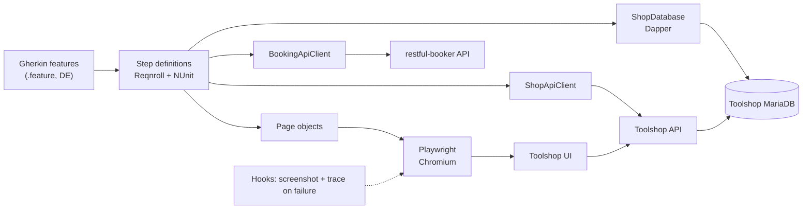
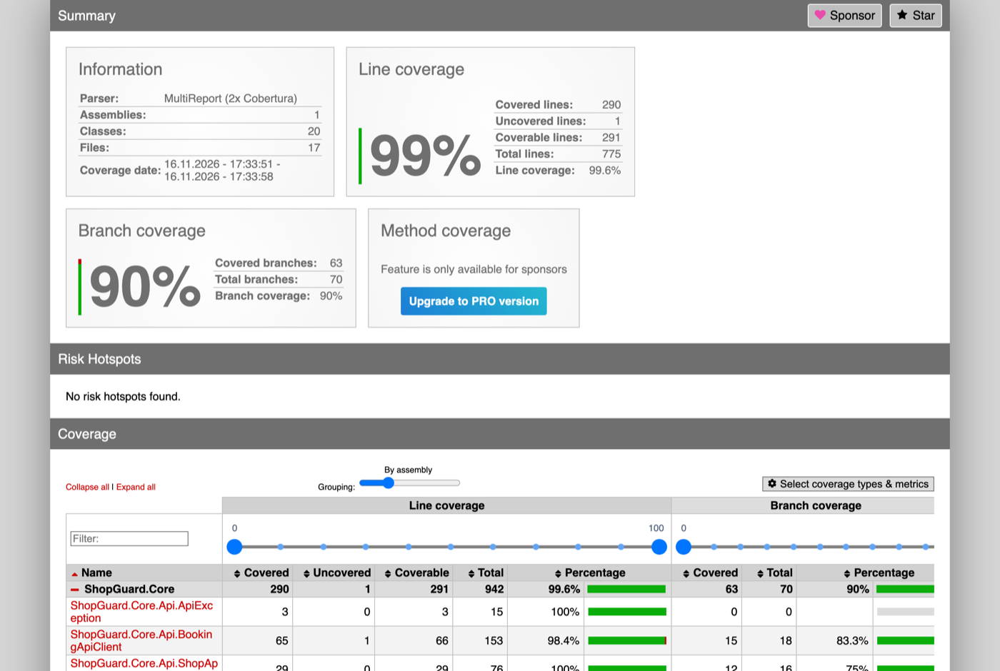
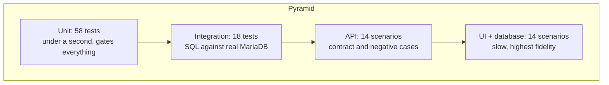

<p align="center">
  
</p>

<p align="center">
  <a href="https://github.com/AdrianDeutsch/ShopGuard/actions/workflows/ci.yml"></a>
  <a href="https://adriandeutsch.github.io/ShopGuard/coverage/index.html"></a>
  <a href="https://adriandeutsch.github.io/ShopGuard/"></a>
  
  
  
  <a href="LICENSE"></a>
</p>

<p align="center">
  
  <br><em>A real end-to-end run: login → product search → cart → checkout with order confirmation</em>
</p>

**ShopGuard** is a behaviour-driven test-automation framework for a demo web shop and a REST API.
Gherkin scenarios (Reqnroll) drive Playwright UI tests, typed API clients and checks against the
shop's own database. A scenario can place an order in the browser and then verify in MariaDB
that the shop stored exactly what it confirmed to the customer.

| Layer | Tests | Runs | Against |
|---|---|---|---|
| Unit | 58 | hosted CI | mocked `HttpMessageHandler`, no network |
| Integration | 18 | hosted CI | MariaDB 10.6 in a container (Testcontainers) with the shop's table definitions |
| API | 14 | hosted CI | [restful-booker](https://restful-booker.herokuapp.com) |
| UI + database | 14 | local `pre-push` gate | self-hosted [Toolshop](https://practicesoftwaretesting.com) (Angular, Laravel, MariaDB) |

Hosted CI runs on every push to `main`, on every pull request and once a week. The UI scenarios
are not part of it; [why](#why-the-ui-suite-runs-locally) is explained below.

> The Gherkin scenarios are written in German (the project's domain language); code and comments are in English.

---

## Contents

- [What it shows](#what-it-shows)
- [Example scenario](#example-scenario)
- [Architecture](#architecture)
- [Reports](#reports)
- [Quick start](#quick-start)
- [Test strategy](#test-strategy)
- [Why the UI suite runs locally](#why-the-ui-suite-runs-locally)
- [Configuration](#configuration)
- [Project structure](#project-structure)
- [CI/CD pipeline](#cicd-pipeline)
- [Defect management](#defect-management)
- [Bonus: Playwright with TypeScript](#bonus-playwright-with-typescript)

---

## What it shows

- **One scenario across three layers.** An order is placed through the UI and then checked in the
  shop database: one invoice for the number shown, the right customer, total and positions equal
  to the cart, status and payment method as chosen.
- **Test data through the API, behaviour through the UI.** Every scenario that needs a customer
  gets its own account via `POST /users/register`. Only the registration scenarios use the form.
- **The framework's own SQL is tested.** `ShopDatabase` runs against a real MariaDB in a container,
  created from a snapshot of the shop's table definitions. That covers cases a healthy shop does
  not produce on demand: no payment or two payments, a duplicate invoice number, an order
  without account.
- **A defect traced to its layer.** [DEFECT-003](docs/defects/DEFECT-003.md) started as a timeout
  in the checkout. Form value, request body and database row show that the registration form
  never sends the house number. The expected behaviour is kept as a `@wip` scenario that turns
  green once the shop is fixed.
- **Coverage is enforced, not claimed.** CI fails below 90 % line coverage of `ShopGuard.Core`
  (currently 99.6 %). The badge above is generated by the pipeline.
- **Failures leave evidence.** A failed UI scenario saves a full-page screenshot and a Playwright
  trace; every run writes an HTML report with the result of each step.

---

## Example scenario

From [`Features/DB/Bestellvalidierung.feature`](ShopGuard/ShopGuard.E2ETests/Features/DB/Bestellvalidierung.feature)
(in the file, the two `Given` steps are the feature's `Background`):

```gherkin
@ui @db @e2e @regression
Scenario: Eine Bestellung mit einem Produkt wird vollständig und korrekt gespeichert
  Given ich besitze ein registriertes Kundenkonto
  And ich bin als Kunde angemeldet
  When ich das Produkt "Combination Pliers" über die Suche in den Warenkorb lege
  And ich zur Kasse gehe
  And ich den Checkout mit Standardadresse und Zahlung per Nachnahme abschließe
  Then erhalte ich eine Bestellbestätigung mit Rechnungsnummer
  And ist zur Rechnungsnummer genau eine Rechnung in der Shop-Datenbank gespeichert
  And gehört die Rechnung zum angemeldeten Kunden
  And entspricht der gespeicherte Rechnungsbetrag der Summe der bestellten Produkte
  And enthält die Rechnung genau die bestellten Produkte mit Menge und Preis
  And hat die Rechnung in der Datenbank den Status "AWAITING_FULFILLMENT"
  And ist als Zahlungsart "cash-on-delivery" gespeichert
```

The account comes from the API, the order from the browser, the assertions from SQL
([`ShopDatabase.cs`](ShopGuard/ShopGuard.Core/Database/ShopDatabase.cs)). The database is only
read: everything in it was created by the shop itself.

---

## Architecture



Everything reusable lives in `ShopGuard.Core`: both API clients, the database access, price
arithmetic, the test-data generator and the configuration loader. It is covered by unit and
integration tests, so the E2E layer stays thin: step definitions translate a sentence into one
or two calls.

---

## Reports

**Live on GitHub Pages:** https://adriandeutsch.github.io/ShopGuard/, refreshed by every run on `main`.

| Report | Content |
|---|---|
| Test report | Result of every API scenario of the latest run, step by step (Reqnroll HTML formatter) |
| Living documentation | All features and scenarios, including the UI and database ones |
| Code coverage | Line and branch coverage of `ShopGuard.Core` from unit and integration tests |


<br><em>Coverage report (ReportGenerator), merged from the unit and the integration test run</em>

The local gate writes the same kind of report for the UI and database scenarios to
`ShopGuard/ShopGuard.E2ETests/bin/Debug/net10.0/reqnroll-report.html`. For a failed UI scenario,
screenshot and trace are in `artifacts/` next to it (open a trace with `playwright show-trace <trace.zip>`).

---

## Quick start

Requirements: .NET SDK 10, and Docker for steps 4 and 6.

1. **Clone and build**
   ```bash
   git clone https://github.com/AdrianDeutsch/ShopGuard.git && cd ShopGuard
   dotnet build ShopGuard
   ```
2. **Install the Playwright browser** (once)
   ```bash
   dotnet tool install --global Microsoft.Playwright.CLI
   cd ShopGuard/ShopGuard.E2ETests && playwright install chromium && cd ../..
   ```
3. **Unit tests** (under a second)
   ```bash
   dotnet test ShopGuard/ShopGuard.UnitTests
   ```
4. **Integration tests** (start a MariaDB container on their own)
   ```bash
   dotnet test ShopGuard/ShopGuard.IntegrationTests
   ```
5. **API scenarios**
   ```bash
   dotnet test ShopGuard/ShopGuard.E2ETests --filter "TestCategory=api"
   ```
6. **UI and database scenarios** against your own Toolshop
   ```bash
   scripts/start-toolshop.sh
   SHOPGUARD_ENV=selfhosted dotnet test ShopGuard/ShopGuard.E2ETests --filter "TestCategory=ui&TestCategory!=wip"
   ```
   The script starts the containers, waits for the API, seeds the catalog if it is empty and
   waits for the UI. The first start builds the Angular app inside the container and takes a
   few minutes. Watch the browser with `HEADLESS=false`.
7. **Enable the gate** (runs step 6 before every push)
   ```bash
   git config core.hooksPath .githooks
   ```
   Skip it once with `SKIP_UI_TESTS=1 git push`.

---

## Test strategy



**Tags** (Reqnroll tags become NUnit categories, selected with `--filter "TestCategory=..."`):

| Tag | Meaning | Where it runs |
|---|---|---|
| `@api` | REST scenarios against restful-booker | hosted CI |
| `@ui` | Playwright scenarios against the Toolshop | local `pre-push` gate |
| `@db` | scenario also checks the shop database; skipped with a reason when the target offers no database access | local `pre-push` gate |
| `@smoke` | critical path, for a quick subset | filter on demand |
| `@regression` | everything beyond the critical path | filter on demand |
| `@e2e` | complete order flow from login to confirmation | part of `@ui` |
| `@wip` | unstable, or the expected behaviour of an open defect | no gate |

Of the 14 gate scenarios, 11 are UI-only and 3 also assert on the database. One more scenario is
tagged `@wip @defect-003` and is red on purpose.

How flakiness is detected and handled is written down in [FLAKY-TESTS.md](FLAKY-TESTS.md).

---

## Why the UI suite runs locally

The UI suite needs a running shop.

- The **public** Toolshop sits behind a Cloudflare bot challenge that triggers for data-center
  IPs. Working around bot protection is not an option for a test suite.
- The **self-hosted** Toolshop is heavy for a push pipeline: the UI container builds the Angular
  app on every start, which takes several minutes, and the upstream images mix CPU
  architectures (API and UI are amd64, the nginx front is arm64), so a hosted runner has to
  emulate one of them.

On a developer machine with Docker Desktop the stack starts once and stays up. The UI and
database scenarios are therefore enforced there, by a git hook:

```bash
git config core.hooksPath .githooks   # enable once
```

On every `git push`, [`.githooks/pre-push`](.githooks/pre-push) calls
[`scripts/start-toolshop.sh`](scripts/start-toolshop.sh) and runs the `@ui` scenarios against
`http://localhost:4200`. A red suite blocks the push.

For a run without a developer machine there is [`ui.yml`](.github/workflows/ui.yml): a manually
triggered workflow that starts the same stack on a hosted runner, with QEMU for the arm64
container, and runs the same scenarios.

The image versions are pinned in [docker/toolshop.compose.yml](docker/toolshop.compose.yml).
The system under test only changes when that file changes: a disposable instance with a known
version and seeded data, not a shared system somebody else can update.

---

## Configuration

[`appsettings.test.json`](ShopGuard/ShopGuard.E2ETests/appsettings.test.json) holds the defaults
and one section per target environment, selected with `SHOPGUARD_ENV`. Values are resolved in
three layers, the last one wins:

1. section `TestSettings` (defaults, public demo systems)
2. section `Environments:<name>` (for example `selfhosted`: local URLs and the database)
3. environment variables `SHOPGUARD_<Property>`, for example `SHOPGUARD_ApiPassword`

The file only contains the published credentials of the demo systems and of the local Docker
database. A real secret would be passed through layer 3.

---

## Project structure

```
ShopGuard/
├── ShopGuard/
│   ├── ShopGuard.Core/              # Reusable: API clients, ShopDatabase, helpers, configuration
│   ├── ShopGuard.UnitTests/         # 58 NUnit tests, Moq-mocked HttpMessageHandler
│   ├── ShopGuard.IntegrationTests/  # 18 tests against MariaDB (Testcontainers)
│   │   └── Database/toolshop-schema.sql   # snapshot of the shop's table definitions
│   └── ShopGuard.E2ETests/
│       ├── Features/
│       │   ├── UI/                  # Login, search, cart, checkout, registration (Gherkin, DE)
│       │   ├── API/                 # Booking CRUD, auth, negative and contract cases
│       │   └── DB/                  # Order placed in the UI, verified in the shop database
│       ├── StepDefinitions/         # Bindings: thin, logic lives in Pages/Core
│       ├── Pages/                   # Page Object Model (data-test selectors)
│       ├── Database/                # Scenario-scoped access to the shop database
│       ├── Hooks/                   # Browser lifecycle, evidence on failure, @db skip rule
│       ├── Support/                 # Settings, PlaywrightDriver, API contexts, ScenarioState
│       └── reqnroll.json            # incl. the HTML report formatter
├── playwright-ts/                   # Bonus: four UI tests ported to Playwright Test (TypeScript)
├── docker/toolshop.compose.yml      # The shop under test, self-hosted, image versions pinned
├── scripts/start-toolshop.sh        # Starts and seeds the shop; used by hook, workflow and by hand
├── .githooks/pre-push               # Local gate for the UI and database scenarios
├── docs/
│   ├── defects/                     # Defect reports following the Jira template
│   ├── pages/index.html             # Landing page of the published reports
│   ├── JIRA-BUG-TEMPLATE.md
│   └── images/
├── FLAKY-TESTS.md                   # Detecting and handling flaky tests
├── .github/workflows/
│   ├── ci.yml                       # Push pipeline: unit, integration, API, reports
│   └── ui.yml                       # UI and database scenarios on a hosted runner, manual trigger
└── .gitlab-ci.yml                   # The same pipeline ported to GitLab CI (not executed here)
```

---

## CI/CD pipeline

The pipeline runs on **GitHub Actions** ([ci.yml](.github/workflows/ci.yml)) on every push to
`main`, on every pull request and once a week.

| Job | Content | Notes |
|---|---|---|
| `unit` | unit tests, integration tests, coverage report and gate (90 %), coverage badge | fail-fast: if it is red, nothing else runs |
| `api` | `@api` scenarios with HTML report | the suite may be repeated, single scenarios never |
| `pages` | publishes test report, living documentation, coverage and badge to GitHub Pages | only on `main` |

Outside the push pipeline:

| What | Trigger | Content |
|---|---|---|
| `pre-push` hook | every `git push`, locally | `@ui` and `@db` scenarios, see [above](#why-the-ui-suite-runs-locally) |
| [ui.yml](.github/workflows/ui.yml) | manually | the same scenarios on a hosted runner |

The weekly run exists because the API under test belongs to a third party: it can change
without a commit in this repository.

[.gitlab-ci.yml](.gitlab-ci.yml) is a port of the same pipeline to GitLab CI (stages, tag
selection, docker-in-docker for Testcontainers, a project runner for the UI stage). It has not
been executed, because this project is hosted on GitHub.

---

## Defect management

Three documented defects in the systems under test (template: [JIRA-BUG-TEMPLATE.md](docs/JIRA-BUG-TEMPLATE.md)):

| ID | Component | Summary | Root cause |
|---|---|---|---|
| [DEFECT-001](docs/defects/DEFECT-001.md) | API | `POST /booking` returns **418** instead of 4xx without an Accept header | product bug |
| [DEFECT-002](docs/defects/DEFECT-002.md) | API | `POST /auth` returns **200** for invalid credentials | product bug |
| [DEFECT-003](docs/defects/DEFECT-003.md) | UI | Registration form does not send the house number; checkout is blocked later | product bug in the frontend, shown with request body and database row |

Workflow: failure analysis (trace, logs, database) → classification (product, test, flaky) →
report → fix or workaround → retest.

---

## Bonus: Playwright with TypeScript

Four of the UI tests also exist in **Playwright Test (TypeScript)**, with page objects and the
same `data-test` selectors. The port targets the public demo shop by default; `SHOP_BASE_URL`
points it at the self-hosted one.

```bash
cd playwright-ts
npm install && npx playwright install chromium
SHOP_BASE_URL=http://localhost:4200 npx playwright test
```
